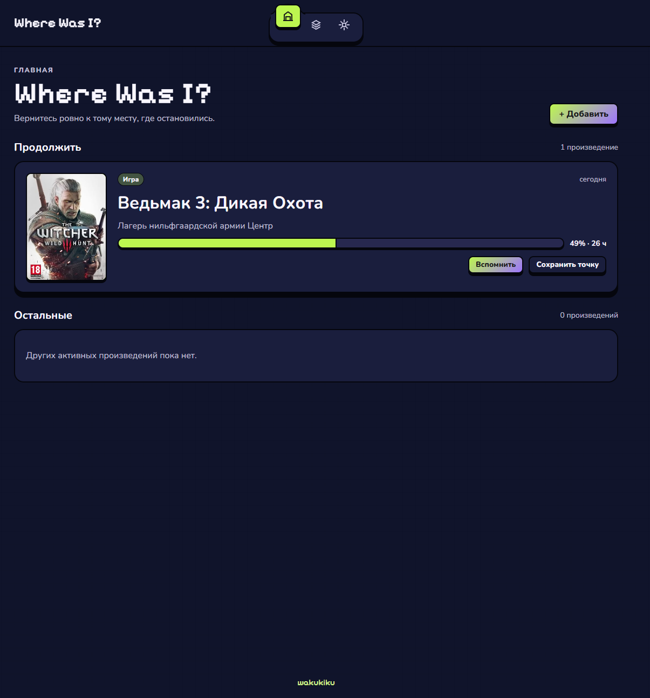
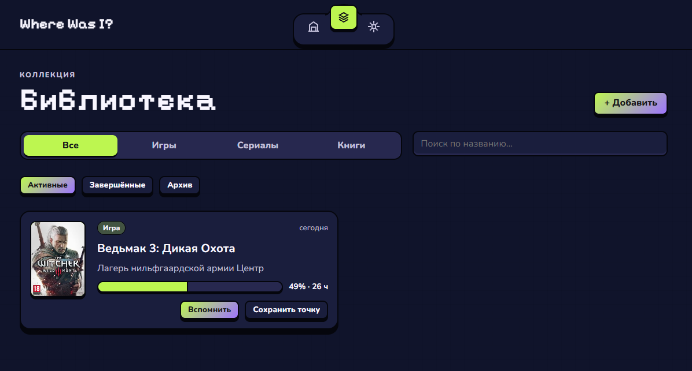
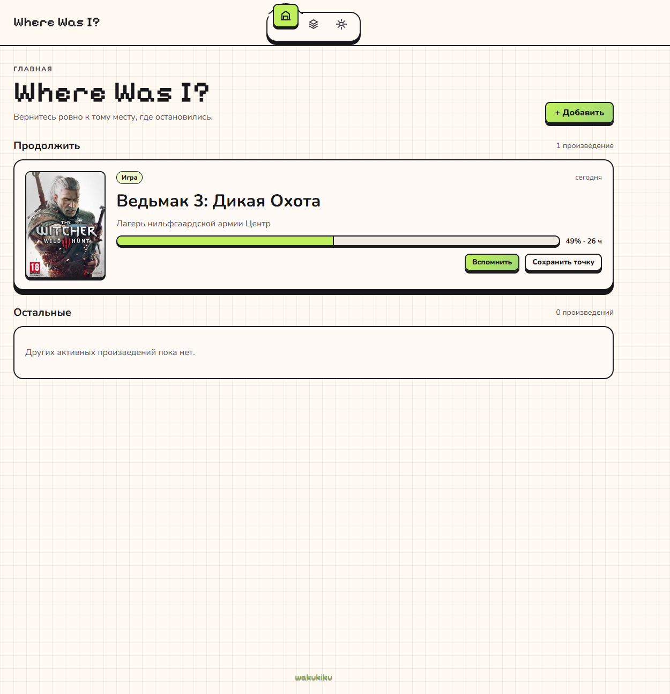
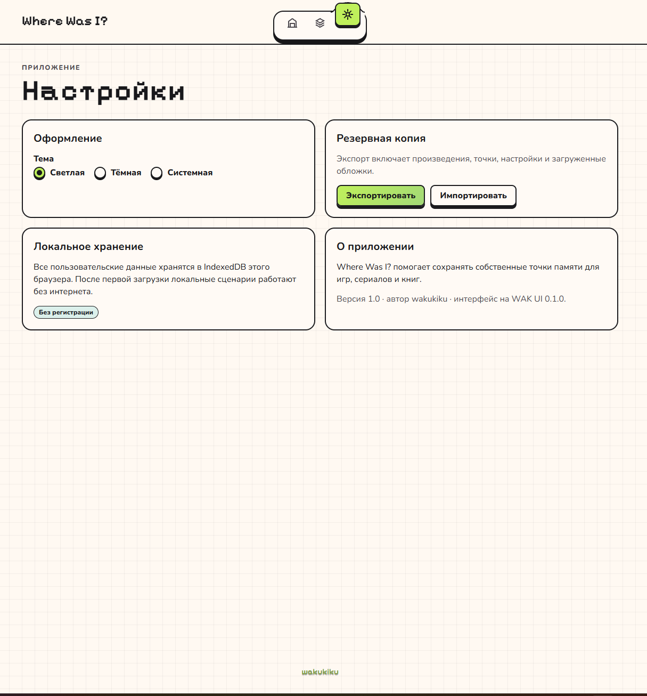
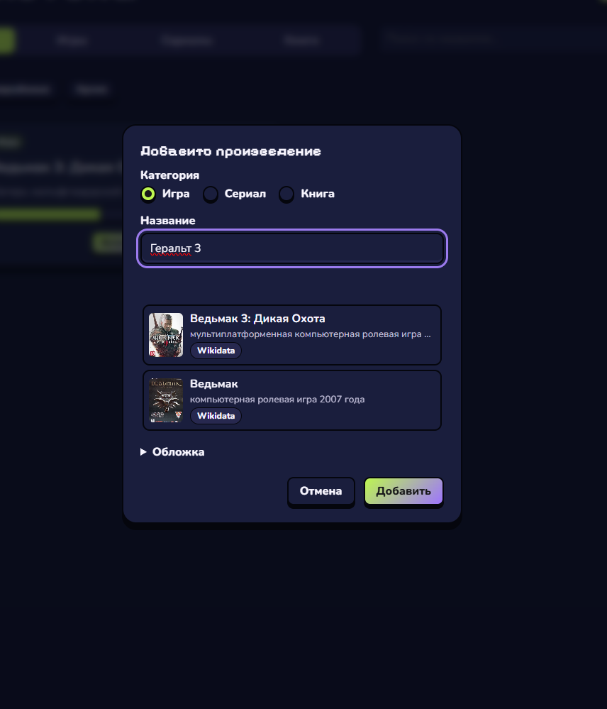

# Where Was I?

Веб-приложение для сохранения прогресса и контекста в играх, сериалах и книгах.

Идея простая: когда возвращаешься к игре или сериалу после долгого перерыва, бывает сложно вспомнить, где остановился, что происходило и что собирался делать дальше.

Для этого я сделал Where Was I? — место, в котором можно сохранять собственные точки возврата и восстанавливать контекст, когда он понадобится.

Приложение не требует регистрации и хранит пользовательские данные локально.

## Возможности

- **Библиотека** — игры, сериалы и книги в одном месте.
- **Точки возврата** — сохранение текущего прогресса, событий, заметок и следующих действий.
- **История** — просмотр и редактирование предыдущих точек.
- **Режим «Вспомнить»** — быстрый возврат к сохранённому контексту.
- **Гибкий прогресс** — проценты и часы для игр, сезоны и серии для сериалов, главы и страницы для книг.
- **Поиск произведений** — автоматический поиск по русским, оригинальным и альтернативным названиям.
- **Обложки** — автоматическая загрузка из каталогов или добавление собственного изображения.
- **Закрепление** — возможность выбрать главное произведение.
- **Статусы** — активные, завершённые и архивные произведения.
- **Резервные копии** — экспорт и восстановление локальной библиотеки.
- **Темы оформления** — светлая, тёмная и системная.
- **PWA** — возможность установить приложение и пользоваться сохранёнными данными без интернета.

## Интерфейс

Интерфейс разработан на моей библиотеке компонентов [WAK UI](https://github.com/wakukiku/wak-ui).

Для приложения используются её компоненты, пиксельная типографика, темы оформления и тактильные анимации.

Поддерживаются десктопные и мобильные экраны.

### Тёмная тема





### Светлая тема





### Добавление произведения



## Стек

| Технология        | Назначение              |
| ----------------- | ----------------------- |
| React             | Интерфейс               |
| TypeScript        | Типизация               |
| Vite              | Сборка                  |
| WAK UI 0.1.0      | Компоненты и оформление |
| IndexedDB / Dexie | Локальное хранение      |
| React Router      | Навигация               |
| Service Worker    | PWA и офлайн-работа     |

## Запуск

Для локального запуска потребуется Node.js 20 или новее.

Клонировать репозиторий:

```bash
git clone https://github.com/wakukiku/where-was-i.git
cd where-was-i
```

Установить зависимости:

```bash
npm install
```

Запустить приложение:

```bash
npm run dev
```

Для сборки production-версии:

```bash
npm run build
npm run preview
```

Проверки проекта:

```bash
npm run typecheck
npm run lint
npm test
```

Браузерные тесты при наличии совместимого Chrome:

```bash
npm run test:e2e
```

## Поиск и обложки

Поиск работает с открытыми каталогами произведений:

| Категория | Источники              |
| --------- | ---------------------- |
| Игры      | Wikidata, Wikipedia    |
| Сериалы   | TVmaze, Wikidata       |
| Книги     | Open Library, Wikidata |

Поиск учитывает локализованные названия, транслитерацию, сокращения и небольшие опечатки.

Результаты появляются постепенно, а повторные запросы ускоряются за счёт кэширования. Обложки загружаются отдельно от основного содержимого и по возможности сохраняются локально.

Если произведение отсутствует в каталоге, его можно добавить вручную.

Для базовой работы API-ключи не требуются.

Дополнительно поддерживается подключение собственного игрового каталога через серверный proxy с переменной окружения `VITE_GAME_SEARCH_PROXY`. Секретные ключи внешних сервисов не должны передаваться в клиентскую сборку.

Данные TVmaze используются с атрибуцией источника согласно условиям CC BY-SA. При использовании внешних каталогов необходимо учитывать их правила и ограничения запросов.

## Хранение данных

Where Was I? работает по принципу local-first.

Произведения, точки возврата, черновики, настройки и локально загруженные обложки сохраняются в IndexedDB браузера.

Каждая точка хранит собственный прогресс и заметки. Новые записи не перезаписывают историю.

Для резервного копирования предусмотрен экспорт библиотеки в JSON. Импорт позволяет восстановить данные из ранее сохранённой копии.

**Важно:** данные привязаны к хранилищу конкретного сайта в браузере. Перед очисткой данных сайта, сменой устройства или браузера рекомендуется экспортировать библиотеку.

Офлайн доступны сохранённые произведения и локальные функции приложения. Поиск новых произведений во внешних каталогах требует подключения к интернету.

## Публикация

Проект собирается в статическое PWA-приложение:

```bash
npm run build
```

Готовая сборка находится в каталоге `dist`.

Для размещения подойдёт статический HTTPS-хостинг. Приложение использует hash-маршрутизацию, поэтому при размещении в корне сайта дополнительная настройка серверных маршрутов не требуется.

## Автор

[wakukiku](https://github.com/wakukiku)

Интерфейс построен на [WAK UI](https://github.com/wakukiku/wak-ui).
